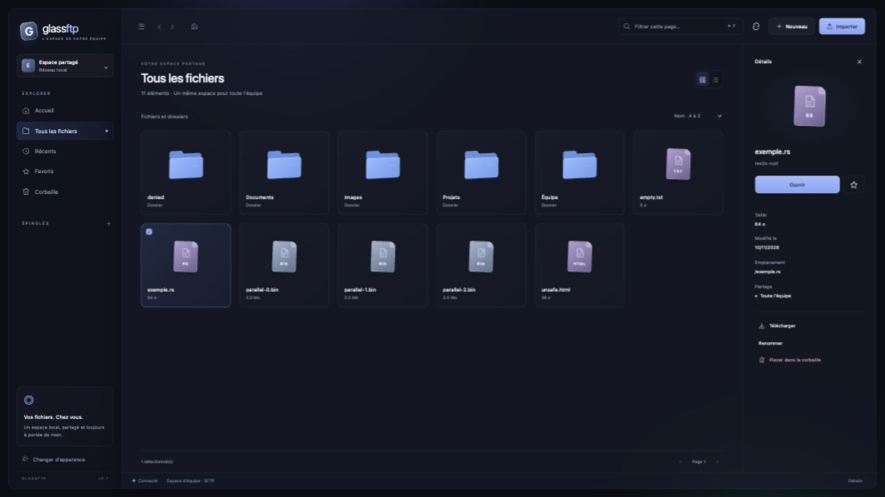

# GlassFTP

Explorateur SFTP partagé en Rust, pour un réseau local. Interface Leptos/WebAssembly, API Axum et accès aux fichiers exclusivement par SSH/SFTP. Aucun compte individuel, aucun CDN, aucune télémétrie ni service cloud.

**État : première version de développement fonctionnelle, non encore qualifiée pour la production.** Le backend et le frontend compilent. Les essais locaux utilisent un véritable serveur SSH/SFTP de test Paramiko, pas un remplacement du stockage dans l’application. Un aller-retour de 2 Gio avec comparaison SHA-256 et cinq clients simultanés ont été vérifiés. La qualification OpenSSH/Nginx/Debian 13 reste à effectuer. Voir [l’état détaillé et les mesures](docs/STATUS.md).

## Démarrer

Prérequis : Rust stable ≥ 1.92, cible `wasm32-unknown-unknown`, compilateur C, `wasm-bindgen-cli` correspondant au `Cargo.lock`, serveur OpenSSH avec extensions `fsync@openssh.com` et `posix-rename@openssh.com` pour l’éditeur.

```sh
rustup target add wasm32-unknown-unknown
cargo install wasm-bindgen-cli --version 0.2.130 --locked --root .tools
bash scripts/build-web.sh
cargo build --locked --release -p glassftp-server
```

Configurer les variables de [.env.example](.env.example). L’application ne charge pas automatiquement un fichier `.env`. En développement, exporter les variables explicitement ou utiliser un lanceur qui charge un fichier de confiance. Les mots de passe ne doivent pas figurer dans une commande conservée dans l’historique.

Pour une connexion réelle, fournir `SFTP_USERNAME`, `SFTP_PASSWORD_FILE`, `SFTP_ROOT` et l’empreinte vérifiée `SFTP_HOST_KEY_SHA256`. Définir `APP_BASE_URL=http://127.0.0.1:8080`, `ASSET_DIRECTORY=dist` et un `DATABASE_PATH` accessible, puis lancer `target/release/glassftp-server`. Le démarrage échoue si la connexion SFTP ou sa sécurité ne peut pas être validée. Il n’existe pas de mode de données fictives.

## Tester sans votre serveur

```sh
cargo test --locked
cargo build --locked -p glassftp-server
bash scripts/build-web.sh
python3 -m venv .tools/venv
.tools/venv/bin/pip install paramiko==4.0.0
.tools/venv/bin/python tests/integration.py
# Ajoutez --large pour tester un aller-retour de 2 Gio et mesurer le RSS.
# Prévoir au moins 3 Gio d’espace temporaire libre pour cet essai.
# Ajoutez --serve pour conserver temporairement l’interface de test sur :18080.
```

Les données de test sont créées dans un répertoire temporaire, les identifiants sont générés aléatoirement, les deux serveurs écoutent sur loopback. Ctrl+C arrête les serveurs et nettoie les données. Ne pas utiliser cette fixture en production.

## Repères



- [Installation Debian 13](docs/DEPLOYMENT.md)
- [Architecture et choix techniques](docs/ARCHITECTURE.md)
- [API et protocole d’upload](docs/API.md)
- [Sécurité et limites de concurrence](docs/SECURITY.md)
- [Tests, fonctionnalités et suites du développement](docs/STATUS.md)

```text
crates/server    API, configuration, journal SQLite, transferts, SSE
crates/sftp      pool SSH, clé hôte épinglée, confinement et I/O SFTP
crates/shared    contrats sérialisés et chemins validés
crates/web       interface réactive Leptos
assets          CSS, icônes SVG, pont navigateur File/Blob
deploy          exemples Nginx, OpenSSH, systemd et nftables
tests           fixture SFTP et tests HTTP de bout en bout
```

Les favoris et les récents sont locaux au navigateur. Les fichiers, les transferts et la corbeille sont partagés. Toute personne autorisée sur le réseau dispose des capacités du compte SFTP commun.
